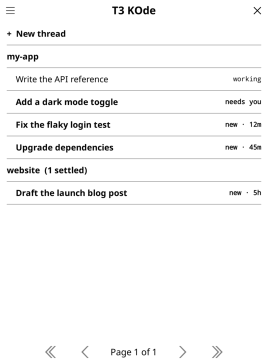
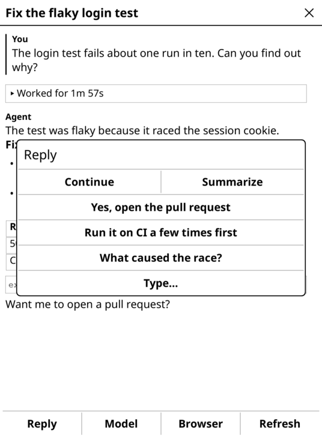
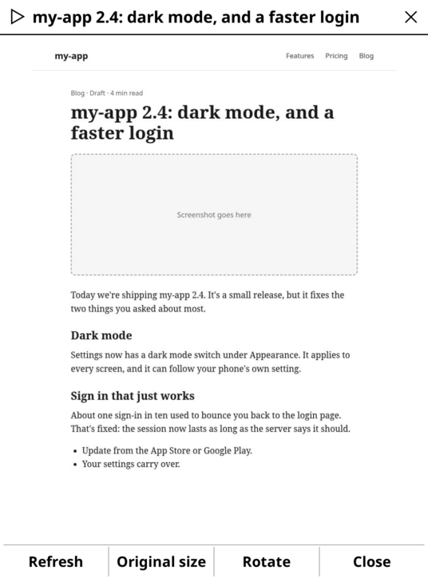
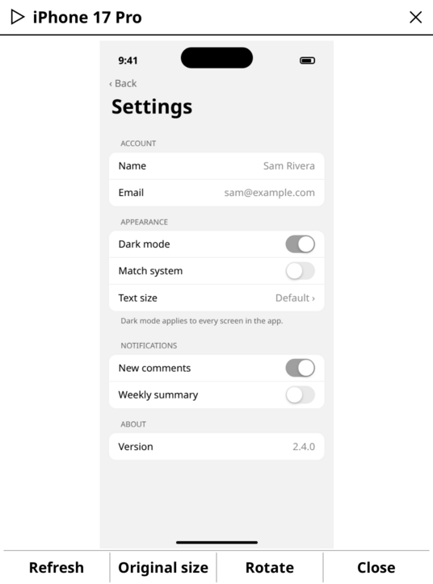
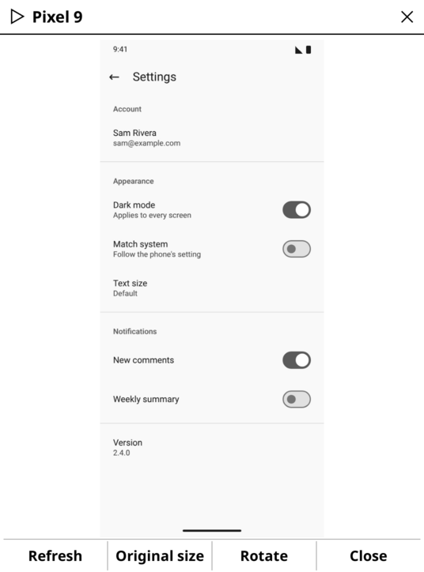

# T3 KOde

[](https://github.com/raywalz/t3kode/actions/workflows/tests.yml)

**T3 Code for e-readers**

A [KOReader](https://koreader.rocks) plugin (Lua) that talks to [T3 Code](https://github.com/pingdotgg/t3code)
through a small bridge (Python) on your computer. Read and reply to threads on a Kobo,
Kindle, PocketBook, or anything else that runs KOReader.

Replying is tap-first: answer the agent's questions and approvals with a tap, pick
one of a few suggested replies, or tap Continue / Summarize / Stop. The on-screen
keyboard is there for everything else.

<p>


</p>
<p>


</p>
<p>



</p>

Status: experimental, but in daily use on a Kobo Clara BW. Tested with T3 Code 0.1.11. The
bridge uses T3's internal API, which can change in any T3 release, so a T3 update may
break it until the bridge catches up ([notes](docs/t3-api.md)).

## What it does

- **Thread list** grouped by project, marked *needs you*, *working*, *done*, or *failed*,
  with unread threads in bold. Subagent threads live under their parent, which shows
  when one of them needs you. Hold a thread to pin it (pinned threads go on top), rename
  it (or let T3 retitle it), snooze it, mark it unread, settle it, or archive it, as in the app's thread menu. Inside a thread, hold its title for the same menu; afterwards you're back in the list. Hold a project's name to start
  a new thread in it.
- **Thread view** that reads well on e-ink: formatted messages (headings, lists,
  tables, code), tool calls collapsed into one-line markers, and finished turns folded
  into "Worked for 1m 12s" like T3's own apps, with the files a turn changed in one
  line under its reply ("3 files changed · +120 −30"; tap it for the list). Tap a fold to see its steps, or a
  subagent to open its thread. Text you quoted from a reply shows as a quote, with your
  comment under it. Images in replies and attachments show inline (shrunk
  and grayscale when ImageMagick is installed); tap one to view it full screen.
- **Replies:** T3's pending approvals (Allow / Allow for session / Decline) and questions
  (single or multiple choice) are buttons, answered the same way the desktop app
  answers them. After each turn, a small model suggests a few likely replies; the
  Reply button offers them, with Type… below. Typed replies use a box that grows
  with the text.
- **Plan mode:** the Plan toggle in the reply box (and when starting a thread) has the
  agent propose a plan first. When a plan is waiting, an Implement plan button starts the
  work, the same as the app's Implement. Typing a reply with Plan on revises the plan.
- **Task list:** while the agent works through a to-do list (its to-do tool or plan
  updates), the thread ends with it, like the app's "Tasks 3/7": done steps ticked, the
  current one in bold. It updates as steps finish.
- **Context usage:** the end of a thread shows how full the agent's context window is
  ("22% of context used (220k of 1m)"), as T3's context meter does.
- **Voice replies (optional):** **Call me** in the Reply menu has the bridge ring your
  phone through Twilio. Talk, then press 1 to send what you said, or hang up and it opens
  in the reply box to check and send. New threads have it too. See [Voice replies](#voice-replies-optional).
- **Queued messages:** while the agent works, a typed reply can wait for the turn to end
  (Queue) or go into the running turn (Steer). Queued messages show at the end of the
  thread; tap one to send it now, steer with it, or remove it. After Stop, a paused
  queue can be resumed.
- **Usage:** the list's menu has **Usage**: what the agents cost and how many tokens they
  used today (by hour), in the last 7 days or this month (by day), by model and provider,
  from the same scan as T3's Usage page. It needs the token's `diagnostics:read` scope.
- **Pull requests** linked to a thread show at its end with their status: open, draft
  or merged, checks, review, and conflicts. Tap one to read it: its checks, description,
  conversation, review comments, commits and changed files, and the threads linked to it.
  The list's menu has **Pull requests**: yours and those waiting for your review, or
  everyone's open ones, as T3's Pull requests page lists them. View only.
- **Model picker:** a thread's Model button switches the model its next turn uses, and
  a new thread can start on any model. Your T3 favorites come first, then More models…
  for the rest (minus the ones you've hidden in T3).
- **Preview:** a thread's Preview button shows what its preview browser tabs and its iOS
  Simulator or Android Emulator show right now, as a grayscale snapshot; Refresh takes a
  new one. View only: nothing is clicked or tapped, and the agent keeps control. Tabs open
  in the desktop app's own window can't be shown.
- **E-ink friendly updates:** the screen redraws only when what it shows changes, without
  a full-screen flash. Optionally, follow a turn's steps as they happen.
- **Reconnects** when the device wakes up: KOReader turns Wi-Fi off for sleep, so with
  T3 open the plugin turns it back on and refreshes, and any tap that needs the bridge
  turns Wi-Fi on first. A retried tap is never sent twice.

## How it fits together

```
e-reader (KOReader + t3.koplugin)  ──HTTP/JSON──▶  bridge  ──T3's API──▶  T3 Code server
```

- **The bridge** (`bridge/`, Python 3.12, standard library only) runs next to the T3
  server. It holds the T3 credential, talks to T3's HTTP and WebSocket API, and serves
  a small, e-ink-friendly API to the device. It also generates suggested replies with
  any OpenAI-compatible endpoint.
- **The plugin** (`plugin/t3.koplugin`) is a thin client built from KOReader's own
  widgets. All T3-specific work happens on the bridge.

## Setup

Three parts: run the bridge next to T3, let the e-reader reach it, and install the
plugin. You don't need SSH access to the e-reader; a USB cable is enough.

### 1. Run the bridge

Needs Python 3.12 and a T3 Code server on the same machine. There are no dependencies.

```sh
git clone https://github.com/raywalz/t3kode && cd t3kode
cp .env.example .env    # then fill it in; every setting is explained there
cd bridge && python3 -m t3bridge
```

`.env` needs at least:

- `T3_TOKEN`: a scoped session token. Mint one with
  `t3 auth session issue --scope orchestration:read --scope orchestration:operate --scope filesystem:read --scope diagnostics:read --ttl 30d --token-only`.
  (`filesystem:read` lets the bridge show images that agent replies point to; leave it
  out and those show as placeholders. `diagnostics:read` lets it show usage stats.)
  Set `T3_TOKEN_COMMAND` to that same command and the bridge renews the token by itself.
- `BRIDGE_TOKEN`: a secret the e-reader sends. Make one with
  `python3 -c 'import secrets; print(secrets.token_urlsafe(24))'`.
- `BRIDGE_HOST`: where the bridge listens. See step 2.
- Optionally `SUGGEST_URL`, `SUGGEST_API_KEY`, `SUGGEST_MODEL` for suggested replies.

Check it from the same machine:

```sh
curl -H "authorization: Bearer $BRIDGE_TOKEN" http://<bridge host>:8787/v1/threads
```

To keep it running, install it as a systemd user service. The steps are at the top of
[contrib/t3-bridge.service](contrib/t3-bridge.service).

### 2. Let the e-reader reach the bridge

Pick one.

**Same Wi-Fi.** The simplest, and enough if you only use it at home. Set `BRIDGE_HOST`
to the computer's address on your network (`hostname -I` on Linux,
`ipconfig getifaddr en0` on a Mac), for example `192.168.1.20`. The bridge address is
then `http://192.168.1.20:8787`. Reserve that address for the computer in your
router's DHCP settings so it doesn't change. This is plain HTTP, so anyone on the same
network could read the token: fine at home, not on public Wi-Fi.

**A VPN such as Tailscale.** Works from anywhere. Set `BRIDGE_HOST` to the computer's
VPN address (Tailscale's start with `100.`). The e-reader needs Tailscale too. There's
no official app for e-readers, but community projects install it:
[koreader-tailscale](https://github.com/victoria-riley-barnett/koreader-tailscale), a
KOReader plugin that installs and runs Tailscale from KOReader's menu (Kobo, Kindle and
others), or [kobo-tailscale](https://github.com/videah/kobo-tailscale), install scripts
for Kobos. Use Tailscale's kernel (TUN) mode, the default where the device supports it,
as most Kobos do. In userspace mode, apps reach the tailnet only through a proxy, which
T3 KOde hasn't been tested with.

**A public HTTPS address.** Works from anywhere, with nothing extra on the e-reader.
Leave `BRIDGE_HOST=127.0.0.1` and put a tunnel or reverse proxy in front of
`http://127.0.0.1:8787`: Cloudflare Tunnel, Tailscale Funnel (only the computer needs
Tailscale), or Caddy on your own domain. The bridge address is then
`https://your.domain`. The plugin checks the certificate against Mozilla's root list,
which it ships with (KOReader doesn't check by itself), so it needs a certificate from a
public CA and a device clock that's about right.

> [!WARNING]
> Whoever has `BRIDGE_TOKEN` can drive your coding agents, and they can run commands
> on your computer. Behind a public address, that token is all that stands in the way,
> and the bridge isn't hardened for the open internet (no rate limiting, for one).
> **Set `BRIDGE_TOKEN` even though the bridge listens on loopback**: it only insists
> on a token when it listens beyond loopback, and it can't tell that a tunnel is in front
> of it. Prefer the first two options if they work for you.

### 3. Install the plugin

Connect the e-reader over USB and run:

```sh
cd bridge && python3 -m t3bridge install-plugin /media/$USER/KOBOeReader   # on a Mac: /Volumes/KOBOeReader
```

Give it wherever the e-reader is mounted. It finds KOReader's folder, copies the plugin,
and writes the bridge address and token from your `.env` into the plugin's settings, so
there's nothing to type on the e-reader. For a tunnel, pass its address with
`--url https://your.domain`. Then eject the e-reader and restart KOReader.

Or by hand, using the plugin from the repo or `t3.koplugin.zip` from the
[latest release](https://github.com/raywalz/t3kode/releases/latest):

1. Connect the e-reader and find KOReader's folder on it: `.adds/koreader` on a Kobo
   (`.adds` is hidden; on a Mac, Cmd+Shift+. in the file picker shows it), `koreader`
   on a Kindle, `applications/koreader` on a PocketBook (the Kindle and PocketBook
   paths are untested; corrections welcome).
2. Copy `plugin/t3.koplugin` into its `plugins` folder.
3. Create `settings/t3.lua` in the same KOReader folder:

   ```lua
   return {
       ["bridge_url"] = "http://<bridge host>:8787",
       ["bridge_token"] = "<BRIDGE_TOKEN>",
   }
   ```

4. Eject the e-reader and restart KOReader.

Or copy only the plugin, and enter the settings on the e-reader: open **Tools → T3
KOde**, tap the menu button at the top left → **Settings** (or **Settings** on the
error if it can't connect yet), and set **Bridge address** and **Bridge token**.

Then open **T3 KOde**, the first item in the Tools tab. You can also bind it to a
gesture: the action is "T3 KOde threads".

Your KOReader gestures keep working inside the plugin: edge swipes for brightness
and warmth, multiswipes, corner taps, and swiping down from the top for KOReader's
menu. Swipes go to your gestures first; taps and holds only when they miss a button,
link, or list item.

## Voice replies (optional)

Typing on an e-reader is slow, so the bridge can call your phone and take a spoken
reply instead. Tap **Reply → Call me** in a thread, or **Call me** in the box for a new
thread (pressing 1 then starts the thread with the model and Plan setting chosen there). Your phone rings, it says which
thread you're replying to, and then you talk. Pauses are fine. On the phone:

- **1** sends what you said to the thread.
- **Hang up** (on the phone or the e-reader, or press **#**) puts it in the reply box on the e-reader to check and send.
- Ending with "**send it**" works like pressing 1.
- **9** clears it and starts over.

**Staying on the call.** In Settings, switch **Call me** to *stay on the call*. Then the
call stays up, and the phone works like a microphone for the e-reader, so you can think out
loud while you read: a few seconds after each pause, what you said is added to a draft for
the thread on screen. Under it, the call's row says **Listening** (or "Draft: 12 words"),
next to **Send** and **Hang up**. Nothing covers the thread, so you keep reading and
turning pages, with gaps as long as you like. Tap the draft to see it in the reply box:
**Back** returns to reading and keeps it (with any edits), **Clear** empties it. **1** on
the phone, ending with "send it", or **Send** sends it; **9** clears it. Then go on to the
next thread without hanging up. With a text box open (a reply, or a new thread), the words
go straight into it. Hang up on the phone, with **Hang up** under the thread, or from the
list's menu (which can also start the call); a draft left over opens in the reply box.
After 15 minutes of silence it hangs up by itself.

**OpenAI live transcription (recommended).** With `VOICE_OPENAI_API_KEY` set, OpenAI's
`gpt-live-transcribe` does the transcribing: Twilio streams the call's audio to the bridge
(a WebSocket on the same public address), and the bridge passes the speech on to OpenAI.
It's faster and more accurate than Twilio's own speech recognition, nothing falls between
phrases, and silence isn't sent, so long pauses cost nothing (about 1.7¢ a minute of
speech). Without a key, Twilio's recognition does it, a phrase at a time. Settings on the
e-reader can switch between the two.

You need:

1. A Twilio account out of trial, with a voice-capable phone number (`TWILIO_NUMBER`)
   and a Standard API key (`TWILIO_API_KEY` and `TWILIO_API_SECRET`, with
   `TWILIO_ACCOUNT_SID`).
2. Your phone number as `VOICE_MY_NUMBER`, in `+15555550123` form.
3. A public HTTPS address for Twilio's webhooks. The bridge serves them on
   `127.0.0.1:8791` (`VOICE_PORT`), only under `/voice/<VOICE_WEBHOOK_SECRET>/`, so
   publish just that port, not the device API. With Tailscale:
   `tailscale funnel --bg --https=443 http://127.0.0.1:8791`, then set
   `VOICE_PUBLIC_URL=https://<machine>.<tailnet>.ts.net`. Any tunnel or reverse proxy
   works too.
4. `VOICE_WEBHOOK_SECRET`, a long random string:
   `python3 -c 'import secrets; print(secrets.token_urlsafe(24))'`. It's what keeps
   others from calling the webhooks, so keep it out of logs and screenshots.
5. Save `TWILIO_NUMBER` as a contact on your phone. Phones that screen unknown callers
   answer the call themselves and hang up before you hear it.

Restart the bridge. Its log says "voice replies on", and threads get **Call me**.

Costs are Twilio's: about $1.15 a month for a US number, about 1.4¢ a minute for the
call, and 2.5¢ for each stretch of speech recognized with the default model (as of
2026; see Twilio's voice pricing). A one-minute reply comes to roughly 10¢. Each tap of
**Call me** places a real call. `VOICE_SPEECH_MODEL` picks the recognizer
(default `deepgram_nova-3`) and `VOICE_LANGUAGE` its language (default `en-US`).

## Updating

When there's a new release, the thread list says so at the top. Tap it, then
**Update**: the bridge tests the new version, updates itself and restarts, and then the
plugin updates from the bridge. If the new version's tests fail, nothing changes. A
plugin older than its bridge (say, after you updated the bridge by hand) gets an
**Update T3 KOde on this e-reader** row of its own.

The bridge updates itself only when it runs from a git clone with no local changes,
and only by fast-forwarding to a release tag of that clone's own remote. Otherwise the
row says what's in the way, and you update by hand: `git pull`, restart the bridge,
then tap **Update T3 KOde on this e-reader** (or run `install-plugin` again).

- `python3 -m t3bridge rollback` goes back to the version before the last update;
  restart the bridge afterwards.
- The bridge looks for releases about once a day by asking its git remote for tags.
  `UPDATE_CHECK=0` in `.env` turns that off.
- **Reload T3 KOde** (in the list's menu, or hold an open thread's title; also a
  gesture) loads plugin files you copied over by hand without restarting KOReader.

Updating from 0.1.0, which can't update itself yet, is by hand once.

## Trying it without T3

```sh
cd bridge && python3 -m t3bridge --demo
```

This serves made-up projects and threads (the ones in the screenshots), with canned
replies, so you can try the plugin before setting up T3. Point the plugin at it with
an empty token, or set `BRIDGE_TOKEN`.

## Development

- Tests: `cd bridge && python3 -m unittest discover -s tests`
- Device API: [docs/bridge-api.md](docs/bridge-api.md)
- Notes on T3's API, including which parts look stable: [docs/t3-api.md](docs/t3-api.md)
- `bridge/api_test.py` checks T3's API directly, without the bridge. It reads by default;
  with `--project` it creates a throwaway thread, messages it, and deletes it.

KOReader's desktop build is handy for working on the plugin's screens. Run it with
`EMULATE_READER_W=1072 EMULATE_READER_H=1448 EMULATE_READER_DPI=300` to match a
Kobo Clara BW.

## License

MIT. See [LICENSE](LICENSE).
