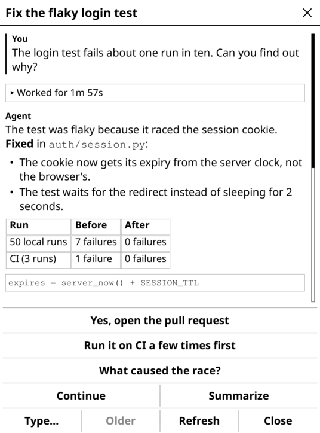
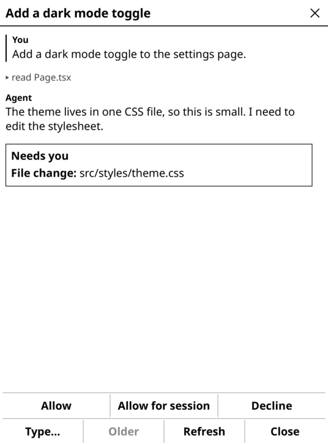

# t3-koreader

Read and reply to [T3 Code](https://github.com/pingdotgg/t3code) threads from an
e-reader running [KOReader](https://koreader.rocks) (Kobo, Kindle, PocketBook, …).

Replying is tap-first: answer the agent's questions and approvals with a tap, pick
one of a few suggested replies, or tap Continue / Summarize / Stop. The on-screen
keyboard is there for everything else.

<p>



</p>

Status: experimental, but in daily use on a Kobo Clara BW.

## What it does

- **Thread list** grouped by project, marked *needs you*, *working*, *done*, or *failed*,
  with unread threads in bold. Subagent threads live under their parent, which shows
  when one of them needs you. Hold a thread to pin it (pinned threads go on top), rename
  it (or let T3 retitle it), snooze it, mark it unread, settle it, or archive it, as in the app's thread menu. Inside a thread, hold its title for the same menu; afterwards you're back in the list. Hold a project's name to start
  a new thread in it.
- **Thread view** that reads well on e-ink: formatted messages (headings, lists,
  tables, code), tool calls collapsed into one-line markers, and finished turns folded
  into "Worked for 1m 12s" like T3's own apps, with the files a turn changed in one
  line under its reply ("3 files changed · +120 −30"; tap it for the list). Tap a fold to see its steps, or a
  subagent to open its thread. Text you quoted from a reply shows as a quote, with your
  comment under it. Images in replies and attachments show inline (shrunk
  and grayscale when ImageMagick is installed); tap one to view it full screen.
- **Replies:** T3's pending approvals (Allow / Allow for session / Decline) and questions
  (single or multiple choice) are buttons, answered the same way the desktop app
  answers them. After each turn, a small model suggests a few likely replies; the
  Reply button offers them, with Type… below. Typed replies use a box that grows
  with the text.
- **Plan mode:** the Plan toggle in the reply box (and when starting a thread) has the
  agent propose a plan first. When a plan is waiting, an Implement plan button starts the
  work, the same as the app's Implement. Typing a reply with Plan on revises the plan.
- **Task list:** while the agent works through a to-do list (its to-do tool or plan
  updates), the thread ends with it, like the app's "Tasks 3/7": done steps ticked, the
  current one in bold. It updates as steps finish.
- **Context usage:** the end of a thread shows how full the agent's context window is
  ("22% of context used (220k of 1m)"), as T3's context meter does.
- **Pull requests** linked to a thread show at its end with their status: open, draft
  or merged, checks, review, and conflicts.
- **Model picker:** a thread's Model button switches the model its next turn uses, and
  a new thread can start on any model. Your T3 favorites come first, then More models…
  for the rest (minus the ones you've hidden in T3).
- **Browser:** a thread's Browser button shows what its preview browser tabs show right
  now, as a grayscale snapshot; Refresh takes a new one. View only: nothing is clicked,
  and the agent keeps control. Tabs open in the desktop app's own window can't be shown.
- **E-ink friendly updates:** the screen redraws only when what it shows changes, without
  a full-screen flash. Optionally, follow a turn's steps as they happen.
- **Reconnects** when the device wakes up: KOReader turns Wi-Fi off for sleep, so with
  T3 open the plugin turns it back on and refreshes, and any tap that needs the bridge
  turns Wi-Fi on first. A retried tap is never sent twice.

## How it fits together

```
e-reader (KOReader + t3.koplugin)  ──HTTP/JSON──▶  bridge  ──T3's API──▶  T3 Code server
```

- **The bridge** (`bridge/`, Python 3.12, standard library only) runs next to the T3
  server. It holds the T3 credential, talks to T3's HTTP and WebSocket API, and serves
  a small, e-ink-friendly API to the device. It also generates suggested replies with
  any OpenAI-compatible endpoint.
- **The plugin** (`plugin/t3.koplugin`) is a thin client built from KOReader's own
  widgets. All T3-specific work happens on the bridge.

## Setup

Three parts: run the bridge next to T3, let the e-reader reach it, and install the
plugin. You don't need SSH access to the e-reader; a USB cable is enough.

### 1. Run the bridge

Needs Python 3.12 and a T3 Code server on the same machine. There are no dependencies.

```sh
git clone https://github.com/raywalz/t3-koreader && cd t3-koreader
cp .env.example .env    # then fill it in; every setting is explained there
cd bridge && python3 -m t3bridge
```

`.env` needs at least:

- `T3_TOKEN`: a scoped session token. Mint one with
  `t3 auth session issue --scope orchestration:read --scope orchestration:operate --scope filesystem:read --ttl 30d --token-only`.
  (`filesystem:read` lets the bridge show images that agent replies point to; leave it
  out and those show as placeholders.)
  Set `T3_TOKEN_COMMAND` to that same command and the bridge renews the token by itself.
- `BRIDGE_TOKEN`: a secret the e-reader sends. Make one with
  `python3 -c 'import secrets; print(secrets.token_urlsafe(24))'`.
- `BRIDGE_HOST`: where the bridge listens. See step 2.
- Optionally `SUGGEST_URL`, `SUGGEST_API_KEY`, `SUGGEST_MODEL` for suggested replies.

Check it from the same machine:

```sh
curl -H "authorization: Bearer $BRIDGE_TOKEN" http://<bridge host>:8787/v1/threads
```

To keep it running, install it as a systemd user service. The steps are at the top of
[contrib/t3-bridge.service](contrib/t3-bridge.service).

### 2. Let the e-reader reach the bridge

Pick one.

**Same Wi-Fi.** The simplest, and enough if you only use it at home. Set `BRIDGE_HOST`
to the computer's address on your network (`hostname -I` on Linux,
`ipconfig getifaddr en0` on a Mac), for example `192.168.1.20`. The bridge address is
then `http://192.168.1.20:8787`. Reserve that address for the computer in your
router's DHCP settings so it doesn't change. This is plain HTTP, so anyone on the same
network could read the token: fine at home, not on public Wi-Fi.

**A VPN such as Tailscale.** Works from anywhere. Set `BRIDGE_HOST` to the computer's
VPN address (Tailscale's start with `100.`). The e-reader needs the VPN too, and there's
no official Tailscale for e-readers, so getting it on takes some tinkering. Best if
you already run it.

**A public HTTPS address.** Works from anywhere, with nothing extra on the e-reader.
Leave `BRIDGE_HOST=127.0.0.1` and put a tunnel or reverse proxy in front of
`http://127.0.0.1:8787`: Cloudflare Tunnel, Tailscale Funnel (only the computer needs
Tailscale), or Caddy on your own domain. The bridge address is then
`https://your.domain`. The plugin checks the certificate against Mozilla's root list,
which it ships with (KOReader doesn't check by itself), so it needs a certificate from a
public CA and a device clock that's about right.

> [!WARNING]
> Whoever has `BRIDGE_TOKEN` can drive your coding agents, and they can run commands
> on your computer. Behind a public address, that token is all that stands in the way,
> and the bridge isn't hardened for the open internet (no rate limiting, for one).
> **Set `BRIDGE_TOKEN` even though the bridge listens on loopback**: it only insists
> on a token when it listens beyond loopback, and it can't tell that a tunnel is in front
> of it. Prefer the first two options if they work for you.

### 3. Install the plugin

Over USB, with no typing on the e-reader:

1. Connect the e-reader and find KOReader's folder on it: `.adds/koreader` on a Kobo
   (`.adds` is hidden; on a Mac, Cmd+Shift+. in the file picker shows it), `koreader`
   on a Kindle, `applications/koreader` on a PocketBook.
2. Copy `plugin/t3.koplugin` into its `plugins` folder.
3. Create `settings/t3.lua` in the same KOReader folder:

   ```lua
   return {
       ["bridge_url"] = "http://<bridge host>:8787",
       ["bridge_token"] = "<BRIDGE_TOKEN>",
   }
   ```

4. Eject the e-reader and restart KOReader.

Or copy only the plugin, and enter the settings on the e-reader: open **Tools → T3
Code**, tap the menu button at the top left → **Settings** (or **Settings** on the
error if it can't connect yet), and set **Bridge address** and **Bridge token**.

Then open **T3 Code**, the first item in the Tools tab. You can also bind it to a
gesture: the action is "T3 Code threads".

To update the plugin, copy the new files over it, then choose **Reload T3 plugin** (from
the list's menu button, or hold an open thread's title). It loads the new code without
restarting KOReader and reopens what you had open. Gesture action: "Reload T3 plugin".

Your KOReader gestures keep working inside the plugin: edge swipes for brightness
and warmth, multiswipes, corner taps, and swiping down from the top for KOReader's
menu. Swipes go to your gestures first; taps and holds only when they miss a button,
link, or list item.

## Trying it without T3

```sh
cd bridge && python3 -m t3bridge --demo
```

This serves made-up projects and threads (the ones in the screenshots), with canned
replies, so you can try the plugin before setting up T3. Point the plugin at it with
an empty token, or set `BRIDGE_TOKEN`.

## Development

- Tests: `cd bridge && python3 -m unittest discover -s tests`
- Device API: [docs/bridge-api.md](docs/bridge-api.md)
- Notes on T3's API, including which parts look stable: [docs/t3-api.md](docs/t3-api.md)
- `bridge/api_test.py` checks T3's API directly, without the bridge. It reads by default;
  with `--project` it creates a throwaway thread, messages it, and deletes it.

KOReader's desktop build is handy for working on the plugin's screens. Run it with
`EMULATE_READER_W=1072 EMULATE_READER_H=1448 EMULATE_READER_DPI=300` to match a
Kobo Clara BW.

## License

MIT. See [LICENSE](LICENSE).
